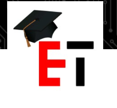

<h1 align="center">
  💻 <a href="https://github.com/TheKT-Github" style="color: #0EA5E9; text-decoration: none;"><strong>Khushi Tiwari</strong></a>
</h1>

### Computer Science Graduate | Full Stack & Java Developer | AI-Driven Application Development

  

  
  
  
  

---

## 🧭 About Me

> Computer Science graduate from GLA University, passionate about building impactful software solutions through thoughtful engineering, continuous learning and practical innovation.

  <code>🏗️ Software Engineering</code> &nbsp;&bull;&nbsp;
  <code>🔄 Full-Stack Development</code> &nbsp;&bull;&nbsp;
  <code>🤖 AI-Driven Solutions</code> 
  <code>🤝 Cross-Functional Collaboration</code> &nbsp;&bull;&nbsp;
  <code>🎯 Continuous Learning & Growth</code>

---

## 💼 Professional Experience

<table>
  <tr>
    <td>
       &nbsp;<strong>Associate Consultant</strong> &nbsp;&bull;&nbsp; <em>Intellect Design Arena Ltd.</em> 
      <code>June 2026 – August 2026</code> &bull; 📍 <code>Chennai, India</code>
      <ul>
        <li>Developed enterprise application components using <strong>Java, Spring Boot and Angular</strong>.</li>
        <li>Configured business workflows using <strong>iTurmeric</strong>.</li>
        <li>Worked on GenAI agents using <strong>Purple Fabric</strong>, exploring agentic AI and multi-agent workflows.</li>
        <li>Collaborated with architecture and QA teams.</li>
      </ul>
    </td>
  </tr>
  <tr>
    <td>
       &nbsp;<strong>Web Development Intern</strong> &nbsp;&bull;&nbsp; <em>Embrizon Technologies</em> 
      <code>May 2024 – July 2024</code> &bull; 📍 <code>Remote</code>
      <ul>
        <li>Developed responsive web interfaces using <strong>React.js, JavaScript, HTML and CSS</strong>.</li>
        <li>Built reusable UI components and implemented state management.</li>
        <li>Performed debugging and improved code maintainability.</li>
      </ul>
    </td>
  </tr>
</table>

---

## 🚀 Featured Engineering Projects

### 1. [Priora — Smart Task Prioritization System](https://github.com/TheKT-Github/Priora)
> **A self-prioritizing engineering task board powered by dynamic real-time mathematical scoring.**

  
  
  
  
  
  
  
  

- **Dynamic Gravity Engine:** Computes real-time mathematical priority scores replacing static labels:
  $$\text{Gravity Score} = (\text{Blast Radius} + \text{Deadline Urgency} + \text{Stagnation} + \text{Blocker Penalty}) \times \text{Workload Multiplier} \times \text{Environment Multiplier}$$
- **Sigmoid Deadline Proximity:** Approaching deadlines scored via continuous curve ($T_{\text{remaining}} - 24\text{h}$) transitioning to overdue penalties.
- **DAG Cycle Prevention:** Pre-commit Breadth-First Search (BFS) reachability validation on task dependency mutations, rejecting circular dependencies ($P \rightarrow T \rightarrow \dots \rightarrow P$) with transactional rollback.
- **Four-Role RBAC:** Strict authorization matrix covering `ROLE_PROJECT_MANAGER`, `ROLE_TEAM_LEAD`, `ROLE_TEAM_MEMBER`, and `ROLE_TESTER`.
- **Three Priority Zones:** Dynamic canvas placement across **Focus Zone** ($\ge 80$), **Drifting Zone** ($50-80$), and **Orbit Zone** ($< 50$ / Completed).
- **Verified Testing:** Validated test suite containing **192 automated unit and integration tests** across 18 test classes (0 failures, 0 errors).

🔗 **GitHub Repository:** [TheKT-Github/Priora](https://github.com/TheKT-Github/Priora)

---

### 2. [StyleSense AI — Fashion Feedback & Product Intelligence Platform](https://github.com/TheKT-Github/feedback-survey-system)
> **End-to-end feedback intelligence platform transforming customer reviews into actionable business insights.**

  
  
  
  
  
  
  
  

- **Seven-Aspect NLP Sentiment Classification:** Classifies customer reviews across 7 fashion dimensions: *Fitting, Quality, Design, Color, Size, Material, and Price*.
- **Multi-Heuristic Spam Detection:** Implements Jaccard token similarity duplicate detection, repetition heuristics, link detection, and sliding-window rate limiting.
- **Retrieval-Augmented Generation (RAG):** Powered by Google Gemini to produce evidence-grounded product comparisons and business recommendations with server-side citation validation to prevent hallucination.
- **Cost-Optimized Fallbacks:** Returns instant `insufficientEvidence` responses without invoking external LLMs when review evidence is below statistical thresholds.
- **Analytics Dashboards & Reports:** Interactive admin metrics with complaint trend momentum tracking and automated PDF and CSV reporting (with formula injection mitigation).
- **Automated Regression Suite:** Master regression audit covering **700+ verified test assertions** across 11 test suites.

🔗 **GitHub Repository:** [TheKT-Github/feedback-survey-system](https://github.com/TheKT-Github/feedback-survey-system)

---

### 3. AttendFlow — Leave Management & Workflow Escalation System
> **A leave management application designed to streamline employee leave requests, multi-stage approvals, and escalation workflows.**

  
  
  
  
  
  

- **Leave Request Submission:** Clean interface for employee leave submission with client-side validation across department, leave type, and duration.
- **Leave Approval Workflows:** Multi-stage review workflows supporting administrative and managerial status progression (Approved, Rejected, Pending).
- **Escalation Handling:** Routing mechanism designed to handle unattended, pending, or time-sensitive leave applications.
- **React-Based Stateful Navigation:** Modular client-side component state machine facilitating smooth step navigation across workflow screens.
- **Flask REST API Integration:** Python Flask backend service providing endpoint parameter validation, structured responses, and persistent MongoDB communication.

> _Note: Project documentation and source code are staged locally and not yet published to GitHub._

---

## 🛠️ Technical Skills

<table>
  <tbody>
    <tr>
      <td width="25%"><strong>Programming Languages</strong></td>
      <td>
        
        
        
        
        
        
        
      </td>
    </tr>
    <tr>
      <td><strong>Frameworks</strong></td>
      <td>
        
        
        
        
        
        
        
        
      </td>
    </tr>
    <tr>
      <td><strong>Databases</strong></td>
      <td>
        
        
        
        
      </td>
    </tr>
    <tr>
      <td><strong>Core Concepts</strong></td>
      <td>
        <code>OOP</code> &bull;
        <code>Data Structures & Algorithms (DSA)</code> &bull;
        <code>DBMS</code> &bull;
        <code>Operating Systems</code> &bull;
        <code>REST APIs</code> &bull;
        <code>Role-Based Access Control (RBAC)</code> &bull;
        <code>SDLC</code>
      </td>
    </tr>
    <tr>
      <td><strong>Tools & Platforms</strong></td>
      <td>
        
        
        
        
        
        
        
      </td>
    </tr>
    <tr>
      <td><strong>AI & Testing</strong></td>
      <td>
        
        
        
        
        
        
        
        
        
        
      </td>
    </tr>
    <tr>
      <td><strong>Cloud & DevOps</strong></td>
      <td>
        
        
        
        
      </td>
    </tr>
  </tbody>
</table>

---

## 📈 Activity & Engineering Metrics

  <table>
    <tr>
      <td width="50%" align="center">
        <strong>GitHub Profile Statistics</strong>  
        
      </td>
      <td width="50%" align="center">
        <strong>Continuous Contribution Streak</strong>  
        
      </td>
    </tr>
    <tr>
      <td colspan="2" align="center">
        <strong>Primary Languages Breakdown</strong>  
        
      </td>
    </tr>
  </table>

---

## 🧩 Problem Solving & Coding Profiles

  

- **150+ Data Structures & Algorithms Problems Solved** across arrays, two pointers, binary search, trees, graphs, and dynamic programming on [LeetCode](https://leetcode.com/u/Tiwari_Khushi/).
- Regular participation in competitive programming contests and algorithmic problem solving.

---

## 📜 Certifications & Achievements

- 🏅 **Purple Fabric Certification:** Agentic AI and Multi-Agent Workflow Development (*Intellect Design Arena Ltd.*)
- 🏅 **iTurmeric Certification:** Low-Code Application Development and Workflow Orchestration (*Intellect Design Arena Ltd.*)
- 🏆 **HCLTech Young Turks 2026:** Certificate of Merit for scoring **97.84 percentile** in Naukri Campus Young Turks 2026.
- 📜 **DevOps & Cloud Computing Certification:** Practical training in cloud infrastructure, containerization, and continuous integration.
- 📜 **Terraform Infrastructure Project Recognition:** Recognition for developing Terraform-based infrastructure as code (IaC) architectures.
- 📜 **Web Development Certification:** Full-stack frontend and responsive web application design.

---

## 🤝 Connect With Me

  
  &nbsp;
  
  &nbsp;
  
  &nbsp;
  

  Designed with precision & engineering discipline &bull; Open for Software Engineering Opportunities

